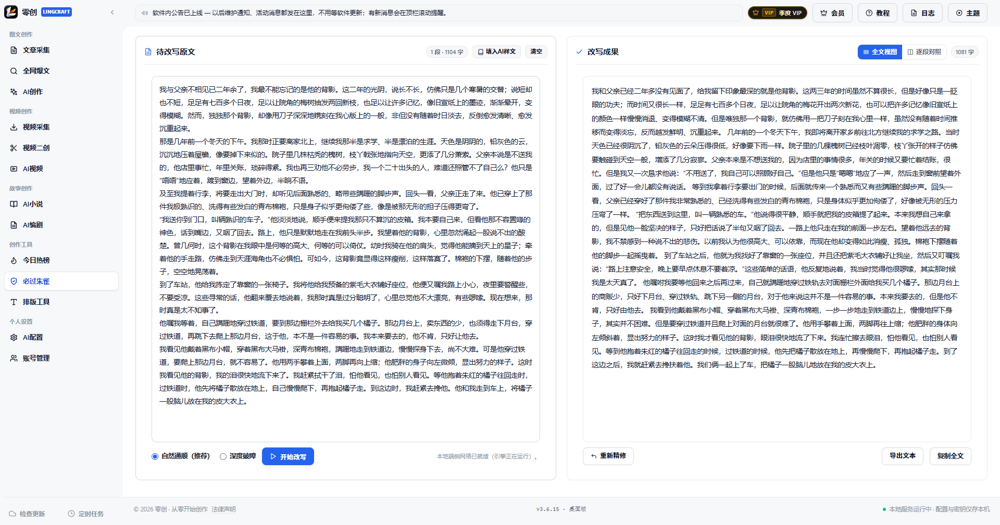
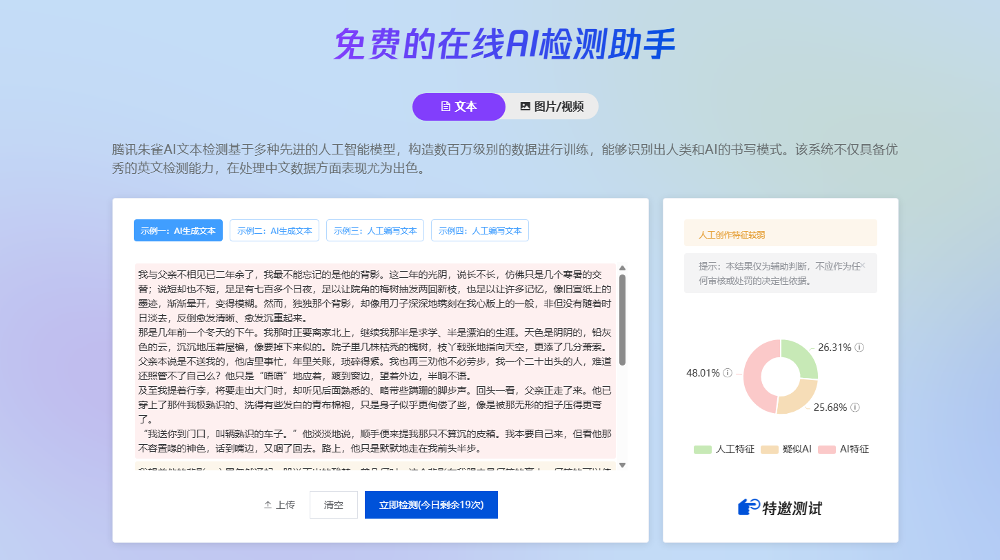
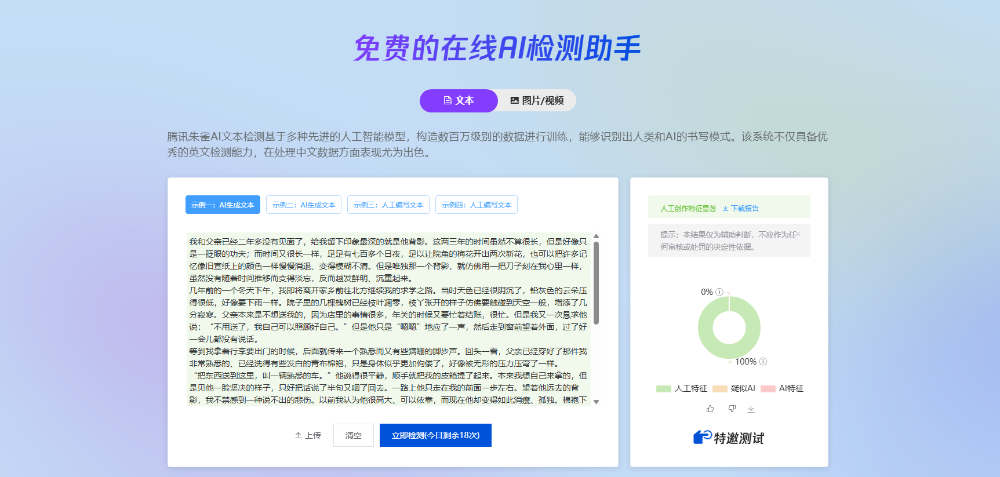

# 零创（LingCraft）· AI 自媒体写作与发布工具

> Windows 桌面 AI 写作与自媒体发布工具：AI 原创、爆款二创、AI 配图，支持今日头条、微头条、百度百家号与微信公众号草稿箱多账号发布，另有视频下载二创、AI 视频、AI 小说与编剧工坊；5.0 起视频可在软件内直接发布到头条与百家号。

> **核心差异点**：内置端侧文本润色——几百次实测，改写后表达更自然、套路句式明显减少（下方有改写前后对照图）。

## 立即下载（当前版本 v5.0.3）

- **[下载 LingCraft_Setup_v5.0.3.exe（安装向导版）](https://www.modelscope.cn/models/lingxiaoyiyu/lingcraft-releases/resolve/master/LingCraft_Setup_v5.0.3.exe)**
  （474.6 MB ｜ Windows 10 / 11 64 位 ｜ 国内直链不限速 ｜ 自动覆盖升级免卸载）
- 文件名：`LingCraft_Setup_v5.0.3.exe`
- 文件大小：497,651,629 字节 / 474.6 MB
- SHA-256：`443078b1282c816e6b9d8c29f89cd66f472706fdba80e7d1ccc44d6d3e69f68e`
*海外与极客备用通道：[GitHub Releases 官方发行页面](https://github.com/lingxiaoyiyu-hub/LingCraft-Release/releases/latest)*

*国内主源：[魔搭 ModelScope 发布页](https://www.modelscope.cn/models/lingxiaoyiyu/lingcraft-releases)*

> 自 2026-10-27 起只提供安装版，**绿色免安装版已停止产出**。安装向导会自动探测旧目录并覆盖升级，作品、账号登录状态与配置全部保留，**不需要先卸载**。

## 文本润色：写完之后先顺一遍

把 AI 生成或二创的稿子交给本机端侧模型润色，降低机械化表达与套路句式；两档强度（自然通顺 / 深度重写），逐段对照、单段精修。改写在本机完成，不上传原文，也不消耗云端模型额度。

**在线试用（每天 3 次免费）**：<https://www.modelscope.cn/studios/lingxiaoyiyu/xcbot>。在线版跑在魔搭云端，需要提交文本；不限次数、批量处理、原文不上传，请用桌面版。

| 改写前 | 改写后 |
| :---: | :---: |
|  |  |

**结论：几百次测试，改写后表达自然度显著提升、套路化表达大幅减少。** 不同检测工具的标准会更新，建议发布前用你常用的工具复测；个别段落不理想时，切「深度破碎」档或对该段重新精修即可。

## 它能做什么

### AI 原创与爆款二创

- **「智能写作」一个面板搞定原创与爆款改写**：贴整篇参考文章就按改写走、贴标题清单就按原创走，按内容自动分流；支持两遍式写作（先事实与结构、再文风精修）、自定义提示词与构思深度，目标字数默认 2000。
- **风格模板**可贴 1~3 篇自己的成稿自建模板，另内置 8 大长文赛道 + 微头条通用共 9 类范文，正文的讲法与语气照你的稿子写。
- 爆款二创先把原文拆成「事实卡」，再只用事实重新组织成新稿，减少原文句式残留；写完后可再过一遍「文本润色」。

### 多平台发布（头条 / 微头条 / 百家号 / 公众号）

- **今日头条**：草稿箱或直接发布，支持批量与软件内定时。
- **微头条**：批量发布与软件内定时，按账号分槽排期。
- **百度百家号**：草稿或直发，支持封面、定时与商品挂载。
- **微信公众号**：一键存草稿箱，内置 28 套排版主题，正文配图自动转存微信图床。
- 头条与百家号登录态物理隔离，账号台账可看分组、粉丝、昨日收入与当日发稿/草稿数。

### 选题下载、视频与故事创作

- **文章下载**：头条作者历史文章与 18 个垂直赛道实时爆文，配图自动下载原图，按文章位置归档。

- **视频下载与二创**：抖音作者主页 / 单作品 / 爆款视频下载；本机 ffmpeg 批量剪辑（裁头尾、变速、转场、片头卡与封面帧、22 款变声），支持按画面比例手动框选处理区域，不覆盖原片、产物落「已润色」目录；全程零联网零模型。

- **AI 视频**：文案 → 口播稿 → 14 款中文音色配音 → 素材混剪 → 双行字幕 → 内置 BGM → 本机合成 MP4。

- **AI 编剧与短剧工坊**：剧本重构 → 视觉资产 → 影视分镜（景别 / 运镜 / 光影 / 音效台词），一键导出 Excel / CSV / Markdown / Word，适配即梦、可灵等生图视频平台。

- **AI 长篇小说工坊**：世界观推演、动态角色档案、分卷细纲、上下文自动记忆逐章扩写，支持 txt / md / docx 导入整部作品，章节可一键「改编剧本」流入短剧工坊。
- **正文连续创作**：点一次按章节顺序自动一章章往下写，每章写完自动定稿（摘要 → 角色履历 → 记忆卡）再续写下一章，中途可随时取消。
- **正文连续创作**：点一次按章节顺序自动一章章往下写，每章写完自动定稿（摘要 → 角色履历 → 记忆卡）再续写下一章，中途可随时取消。

- **AI 配图**：「AI 配置」内含独立「AI 配图」分页，支持 AI 生图与自定义 OpenAI 兼容接口，可当场测试出图。

- **软件内定时发布**：排好时间由软件自动发稿，今日头条与百度百家号均支持；提供固定间隔 / 随机间隔 / 时段内随机 / 每日固定时刻四种节奏与实时预估，任务可逐篇取消、重启后按原节奏恢复（依赖软件保持运行）。

## 三步上手

1. 下载并运行 `LingCraft_Setup_v5.0.3.exe` 进行安装（如遇 Windows SmartScreen 拦截：点「更多信息」→「仍要运行」）。
2. 输入授权卡密激活（老用户覆盖升级免激活，作品与登录凭据全部保留）。
3. 在左侧「AI 配置」填入常用模型 API Key（兼容 DeepSeek / 通义千问 / 智谱清言 / Kimi / OpenAI 格式，另内置「开发者福利 · DeepSeek」免密钥通道，开箱即用），即可开始全流程创作。

## 授权说明

零创是 Windows 桌面商业软件，使用需授权卡密；授权方式与获取渠道见软件官网 xcbot.cyou。

- 卡密一卡一机，支持单机在线核销与每月 2 次自主解绑换机。
- 无积分消耗制，开通后所有模块与功能全部可用。
- 软件内点击「检查更新」即可一键检测并升级最新版。

## 常见问题

**双击被 Windows SmartScreen 拦截？**

点「更多信息」→「仍要运行」。独立商业软件未购买高额 EV 证书时会触发微软拦截提示，本软件通过 Ed25519 签名防篡改核验，绝无任何后门与木马，请放心使用。

**老版本怎么升级？会丢失我写好的文章和小说吗？**

直接下载新版本 Setup 安装包运行覆盖安装即可，**不需要先卸载老版本**。所有作品数据独立保存在本地系统目录，覆盖升级数据毫发无损。

**数据保存在哪里？换电脑怎么备份？**

本机 `C:\Users\<用户名>\AppData\Roaming\XCbot_ToutiaoStudio`。换机前备份该目录，复制到新电脑对应位置即可。

**换电脑了怎么办？**

支持每月 2 次自主解绑换机。在原电脑软件设置中点击「解绑本机」，在新电脑输入原卡密即可直接恢复激活。

**真的能降低机械化表达吗？**

按目前的测试样本（几百篇，覆盖不同题材与长度），改写后套路句式与机械感明显下降，段落衔接更自然。各工具标准会更新，建议发布前复测；不想先装软件，可以先用[在线试用版](https://www.modelscope.cn/studios/lingxiaoyiyu/xcbot)（每天 3 次免费）验证效果。

**端侧 1.5B 润色模型需要独立显卡吗？**

不需要。模型经过底层量化深度优化，普通办公 CPU 即可流畅推理，数秒到十余秒完成一篇 2000 字长文的润色润色。

**公众号能直接群发吗？**

不能。微信接口只开放到草稿箱，零创把稿子和排版存进草稿，最后一步在公众号后台确认发布。

## 相关搜索

AI 写作工具 ｜ 今日头条写作工具 ｜ 微头条发布 ｜ 公众号排版 ｜ 百家号发文工具 ｜ 文章转视频 ｜ 图文成片 ｜ 视频二创 ｜ AI 小说生成 ｜ AI 剧本分镜

## 更新日志

- **v5.0.3**（2026-11-14）：板块下载与全网爆文自动屏蔽官媒及机构号（指定作者链接仍可下载）；修复百家号爆款视频全部下成同一条默认视频、已删头条成「404错误页」并清理旧残留、花生AI 扫码后不立刻识别且音色需重启才刷新、花生AI 方案A 误标「免费」误导等问题；文章与爆文改为并发抓取与并发处理配图大幅提速；精简下载页/AI 配置/视频配音、下线「不停下载」并暂隐「AI编剧」；「零零」小助手换新流线白瓷造型
- **v5.0.2**（2026-11-13）：安装与视频流程修复包——部分电脑双击安装包报错、装不上的问题已修；花生AI 成片跑到最后报错、成片被删已修；视频定时发布一点发送就失败、重启后状态错乱与多账号串扰已修；批量成片出错后状态卡住已修；顶栏新增「官网」「教程」入口
- **v5.0.1**（2026-11-13）：花生AI 修复包——扫码登录窗口一闪就关、免费账号被拦、登录失效提示找不到入口三项问题已修
- **v5.0.0**（2026-11-13）：口播稿交给花生AI 一键剪成片、成品直接进成果库；视频可在软件内一键发布到头条与百家号（自动封面与创作声明，支持批量定时）；文章库与爆文库新增「转视频」「批量成片」；修复会员被误判未激活、公众号草稿配图与封面失败、小说章节超长与二稿覆盖整章、AI 图生视频弹黑窗、黑金主题气泡看不清等 5 项问题
- **v4.0.6**（2026-11-09）：原创与爆款改写合并为「智能写作」按内容自动分流，目标字数默认 2000；小说正文支持**连续创作**，点一次自动一章章往下写、每章自动定稿；公众号存草稿自动设置封面；视频处理新增自动黑边消除、镜头切点吸附与呼吸式微运镜，成片按三段式爆款标题自动改名；修复视频底部字幕被裁、参考资料只剩栏目名、整篇参考文章被拆成标题、配图少配、过程提示写进正文等 7 项问题
- **v4.0.5**（2026-11-07）：侧栏终端小精灵「零零」上线，顶部公告栏改为自适应分屏淡入淡出；配图落盘统一裁底并按段均匀插图；批量创作新增通道预检与跑中熔断；随包提示词降级为骨架、完整模板走云端；客户端清零内置 Key，未激活统一拦截
- **v4.0.4**（2026-11-05）：修复微头条多图只发一张、配图全丢（假成功）、作品声明不生效、点左上角图标跳网页版；会员价格改由服务端下发
- **v4.0.3**（2026-11-03）：修复原创写作空白正文、视频自定义输出目录不生效、头条发布后配图丢失、小说导出两处问题；新增分销白标
- **v4.0.2**（2026-11-01）：账号列表分页、批量导入提速到 3~4 分钟；修复启动误报篡改、创作服务不可用、一张图成片读不到图
- **v4.0.1**（2026-10-31）：批量创作实时进度；修复批量发布统计为 0、浏览器 profile 被抢占、停止视频任务报错、热榜刷不出、标题条数不生效、主题不持久

- **v4.0.0**（2026-10-29）：平台专属模型 **LingCraft v4 Plus** 上线（CPA 侧统一路由、免密钥开箱即用）；修复「一张图 · 纯图文成片」点生成必报错；AI 视频批量生成新增进度面板与独立停止按钮；Key 失效时直接说明原因并给两条恢复路径；修复定时发布标题被写成文件名。

- **v3.6.16**（2026-10-29）：新增**首次启动法律声明确认**——装好后第一次打开必须选择「同意并继续」或「不同意并退出」，同意后写入本机确认记录，此后升级、覆盖安装、重启都不再弹出；法律声明增补「软件定位与内容责任」章节，明确授权前提、禁止用途与责任承担；界面用词统一（「视频成片」改称「视频处理」、入口按钮改称「处理」，「同款结构」子模式改称「爆款改写」，画面修复开关改称「画面修复」）；法律声明弹窗加宽双栏、确认按钮固定在底边；默认主题改为黑金，窗口标题只保留版本号。

- **v3.6.15**（2026-10-27）：新增**长故事创作**——目标字数 6000 字起自动分段规划与合并，固定人物与时间线、隔离前文痕迹，篇幅再长也保持连贯；**AI 配图新增「出图并发」三档（1/3/5 路）**，连续限流自动降速，视频分镜改为并发出图；**爆款选题池持久化**，支持清空与单条删除；修复头条正文注入错编辑器、直发假成功、并发批量丢图，登录失效或当日上限现会暂停整个账号队列；修复百家号发布点不动、配图上传全失败、接口直发报错；修复微头条采集不到配图；修复批量发文勾选残留；ffmpeg 合成稳定性与生图 429 退避优化；福利 AI 通道改为卡密验真，不再向客户端下发共享密钥。
- **v3.6.14**（2026-10-26）：修复 AI 视频「润色」与「生成」按钮点了没反应；二创结果改为每完成一条就实时落盘并刷新成果库；显卡编码探测失败不再静默降级，结果里写明原因（如 `Cannot load nvcuda.dll`），真跑失败时自动改 CPU 重跑该轮；二创启动前预检 ffmpeg 与输出目录，每次任务落一份日志，失败时提示日志路径。
- **v3.6.13**（2026-10-26）：新增**批量生成 AI 视频**——勾选多篇串行「先润色再出片」，失败自动跳过、随时可停；新增**画面修复自动识别**（整批逐片找固定水印，找不到原样放行；手动框选改按画面比例套用，跨分辨率不再错位）；新增**软件内公告栏**与列表**跨分页全选**；修复润色点了不出文章、字数不按档位走；修复配图与段落无关、百家号粉丝与累计收入取不到；批量发布弹窗与视频二创面板尺寸收敛。
- **v3.6.12**（2026-10-22）：左侧栏导航改版（11 个板块分五组，窄窗自动收图标栏）；定时发布改为**按账号分槽**（B 账号排期不再顶掉 A，排队中仍可取消）；新增「爆款视频」独立采集下载与「文本润色」独立板块；画面修复手动框选与 22 款变声上线；第五套主题「纯净白」与书架仿真封面。
- **v3.6.11**（2026-10-17）：**生成中途断流不再掐死整篇**——网络抖动时从断点接着写，不再一次抖动就整篇作废；公众号排版扩到 28 套主题（分隔线、图注、代码块成套造型，文章没有小标题时自动避开并补首段导语）；爆文下载不再入库“只有标题和链接”的空壳，失败逐篇列出原因；二创抽事实卡失败不再只报“隔断层”，长文不再被 90 秒超时误杀；文章成品新增导出单文件 HTML。
- **v3.6.10**（2026-10-15）：**正文改为照你自己的稿子写**——新增「风格模板」，内置 8 大长文赛道与微头条通用共 9 类范文，可「＋ 自定义模板」贴 1~3 篇自己的成稿起名保存反复选用；「自定义提示词」升级为可命名多条、随时关闭的**提示词库**；新增**「软件内定时发布」**与**「环境自检」**；AI 小说新增「改书名」；联网检索多抓几篇再挑可用事实并做同题去重；内置浏览器收敛为只带无头内核，安装包体积明显减小；修复视频下载只抓到 2 秒预告片、坏片残留、定时任务重启后节奏丢失等问题，并修掉自建模板读删接口的路径穿越隐患。
- **v3.6.9**（2026-10-13）：新增「AI 配图」整套能力——AI 配置新增独立「AI 配图」分页，文章创作「配图来源」新增「AI 生图」；新增「AI 联网搜索引擎」（默认免 Key 国内新闻聚合，另可选 Tavily 与博查）；小说新增「导入作品」、自定义分卷数与智能分章；写作语气风格与重写目标风格新增「自定义」档；作者采集新增「导出 HTML」；修复头条草稿箱正文为空、批量发布失败看不到原因等问题。
- **v3.6.8**（2026-10-11）：原创写作加入两遍式写作，第一遍只写事实与结构、第二遍专做文风精修；原创与二创新增「额外素材」；小说章节序号改为全书跨卷连续；修复二创前置失败时静默交出低质稿等问题；爆款选题改为关思考，生成明显提速。
- **v3.6.7**（2026-10-10）：自媒体爆款二创全链路重构，引入「事实卡物理隔绝」机制（先提事实数据线索 ➔ 再独立搭建文章逻辑 ➔ 最后文风润色与出标题），降低与原文的措辞重合；AI 模型配置新增「构思深度」全局开关；账号管理支持点击卡片一键呼出已登录创作后台。
- **v3.6.6**（2026-10-09）：修复免费 AI 写作通道报错、文章生成不出来的问题；修复自定义模型通道被内置通道顶掉；修复 Agnes 免费厂商测试连接报错。
- **v3.6.5**（2026-10-08）：修复长文生成被中途截断；视频下载继续收口（标题与封面、重复下载、时长计算、清空范围、失效短链说明）；创作时不再自动联网搜索；免费通道拥堵时自动切换线路。
- **v3.6.4**（2026-10-08）：抖音采集归属与篇数收口；采集进度实时显示「已入库 N/M 部」；视频库时长自动补齐；修复部分作品封面采集不到。
- **v3.6.3**（2026-10-08）：**视频板块上线**——新增「视频下载」与「视频二创」；新增「开发者福利 · DeepSeek」免费通道并设为默认；新增每小时自动检查更新。
- **v3.6.2**（2026-10-07）：微信公众号发布通道上线（一键存草稿、批量存草稿、配图转微信图床、28 套排版主题）；新增原创与二创「自定义提示词」；修复生成时界面长时间无响应。
- **v3.6.1**（2026-10-04）：配图关键词整条重做；二创升级为两遍式创作；配图来源默认推荐百度搜图。
- **v3.6.0**（2026-10-03）：软件更名为「零创」、标语改为「从零开始创作」，应用图标全新设计；修复批量任务丢失、自动配图不相关等问题。

- **v3.5.18**（2026-10-03）：新板块「全网爆文」上线，可按平台、领域、阅读量与时间实时检索并批量采集；AI 创作新增「微头条」目标平台；配图接入头条正版高清与热点图库。
- **v3.5.17**（2026-10-01）：修复更新后账号与登录状态消失、文章被长度上限截断；新增顶部「运行日志」入口；内置免费通道切换至中国站。
- **v3.5.16**（2026-09-28）：内置 AI 模型通道升级，老用户模型配置就地平滑迁移。
- **v3.5.15**（2026-09-28）：长文生成与多选二创保存加固，更新清单上线 Ed25519 数字签名防篡改校验。
- **v3.5.11**（2026-09-22）：废除增量热更双轨制，全面统一为全量单轨稳定升级，客户端稳定性大幅提升。
- **v3.5.0**（2026-09-08）：重磅上线 AI 短剧分镜工坊，支持影视分镜设计与多格式批量导出。
- **v3.4.0**（2026-08-31）：重磅上线 AI 长篇小说工坊，支持大纲推演与逐章批量扩写。

## 免责声明

本软件为自媒体内容生产与创作辅助工具。用户使用本软件采集素材、生成内容与分发时，应严格遵守国家相关法律法规与第三方平台守则，严禁用于任何侵权、虚假、违规违法的用途。使用本工具产生的衍生内容由使用者自行负责。
## 商业许可与版权声明

LingCraft（零创）为商业授权软件，受《中华人民共和国著作权法》及国际版权公约保护。

- **专有权利**：本软件所有代码架构、编译产物、核心创作模型提示词编排体系及界面设计，其著作权及商业秘密均归开发团队独家所有。
- **禁止行为**：未经官方书面许可，任何组织或个人不得对本软件进行反编译、反汇编、逆向工程、去除授权校验或制作分发衍生破解补丁；不得将本软件用于任何形式的商业转售、倒卖或公开镜像分发。
- **追责声明**：本软件内置云端付费计算资产与动态鉴权审计。对于任何非法破解、盗用商业 Token 及恶意传播侵权版本的行为，官方保留直接诉诸司法机关追究民事索赔及法律责任的一切权利。
- **侵权举报与商务授权**：如发现第三方违规倒卖、破解补丁或侵权线索，欢迎联系官方邮箱：lingxiaoyiyu@gmail.com。

---

© 2026 LingCraft Team. All rights reserved.

## 授权与激活

- 本软件为商业软件，需卡密激活后使用；未激活状态不开放任何功能。
- 老用户覆盖升级免激活，作品、账号登录状态与 AI 配置全部保留，不需要先卸载。
- 会员状态、剩余天数与设备绑定以授权服务器为准，换机请在会员中心走自助解绑。

## 常见问题

**Q：安装时 Windows 提示"已保护你的电脑"？**
点「更多信息」→「仍要运行」。安装包未做代码签名证书，属正常提示。

**Q：升级后账号和作品会丢吗？**
不会。账号登录凭据、作品库、配置都存在用户数据目录，安装向导只覆盖程序本体。

**Q：内置通道和自备 Key 有什么区别？**
内置通道免配置、按次计费，适合直接用；自备 Key 走你自己的账号，额度与模型自选。

**Q：处理视频需要联网吗？**
不需要。视频重剪、画面处理、变声全部在本机 ffmpeg 完成，不上传素材。

## 免责声明

本软件仅提供内容创作与发布辅助工具，不对使用者发布内容的合法性、真实性与平台合规性负责。请遵守各平台社区规范与相关法律法规，因违规使用产生的后果由使用者自行承担。

## 商务合作

批量授权、分销白标与定制需求，请通过仓库 Issues 或软件内「技术支持」联系。