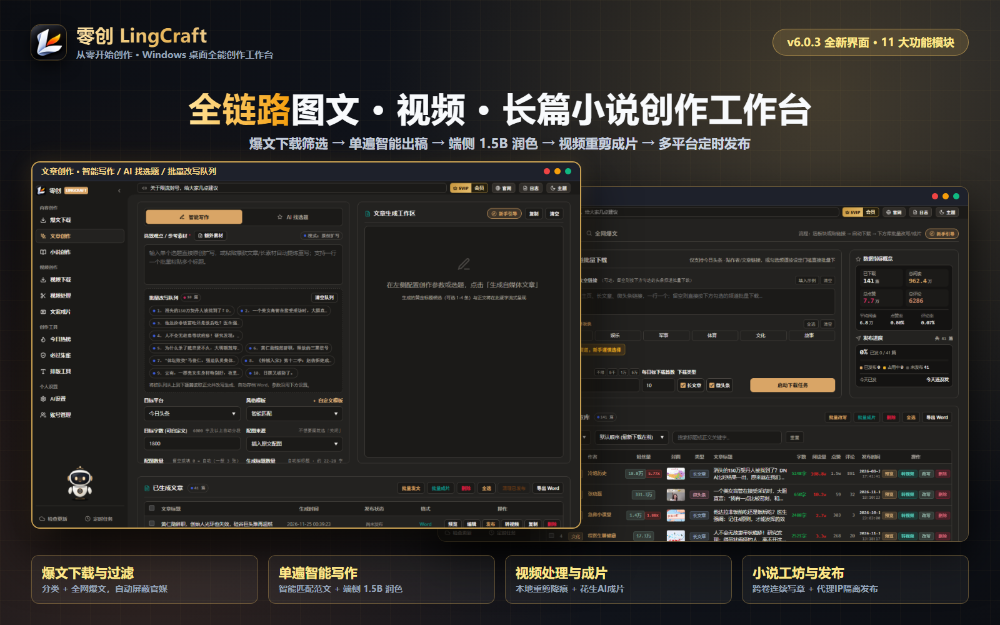
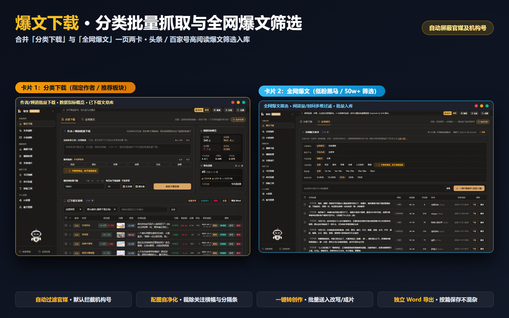
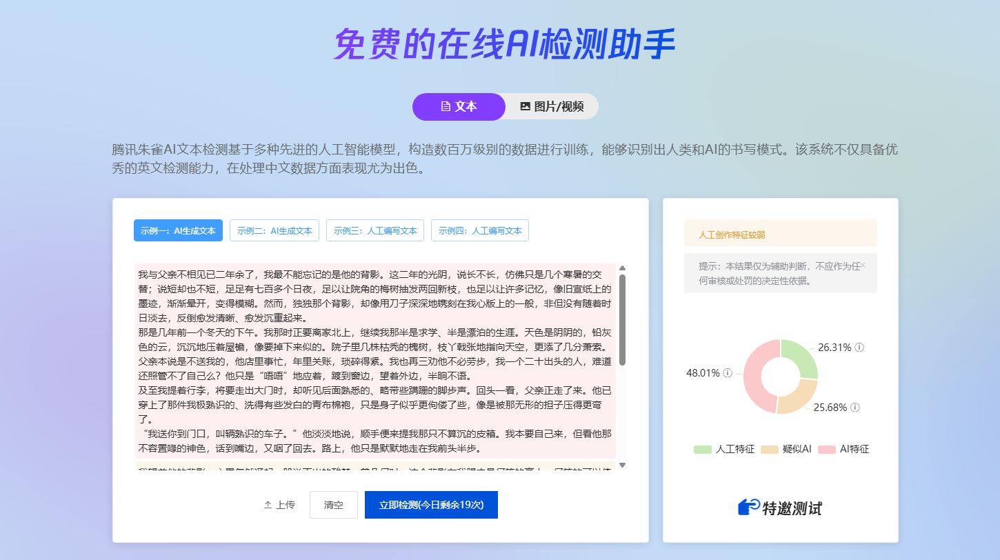
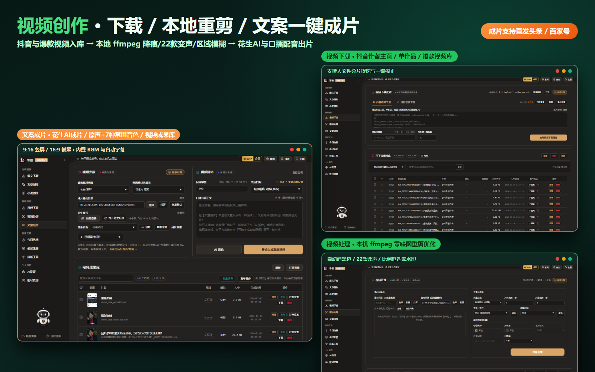
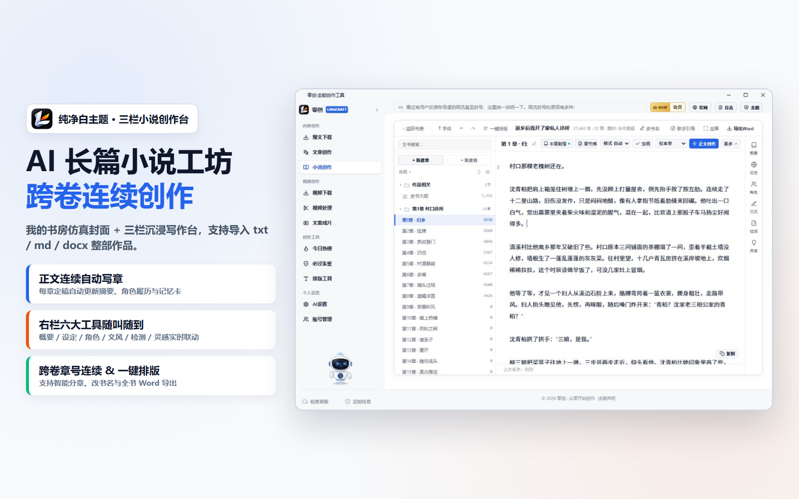
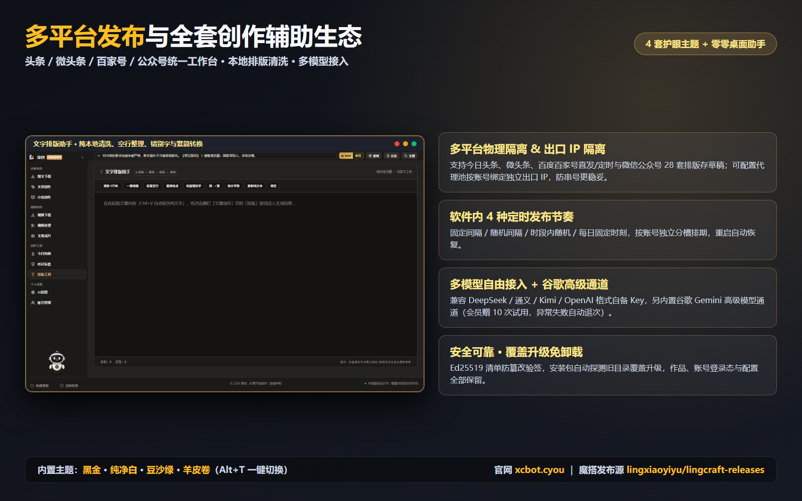

# 零创（LingCraft）· AI 自媒体与长篇小说创作工作台

> Windows 原生桌面创作工作台：爆文下载筛选 → 单遍智能写作 → 端侧 1.5B 本地润色 → 视频下载重剪与文案成片 → AI 长篇小说工坊 → 头条 / 微头条 / 百家号 / 公众号发布与代理 IP 隔离。

> **核心差异点**：内置「必过朱雀」端侧 1.5B 本地文本润色——纯本机运行、不上传原文、不消耗云端模型额度；配合四套护眼主题与桌面小助手「零零」，界面所见即所得。

## 立即下载（当前版本 v6.0.3）

- **[下载 LingCraft_Setup_v6.0.3.exe（安装向导版）](https://www.modelscope.cn/models/lingxiaoyiyu/lingcraft-releases/resolve/master/LingCraft_Setup_v6.0.3.exe)**
  （474.2 MB ｜ Windows 10 / 11 64 位 ｜ 魔搭直链不限速 ｜ 自动覆盖升级免卸载）
- 文件名：`LingCraft_Setup_v6.0.3.exe`
- 文件大小：497,253,204 字节 / 474.2 MB
- SHA-256：`2d96fc7314b6fafd4980a28409171bb131f9b8d6e2c7bc3f2f5da2eb4b770710`
- 海外与极客备用通道：[GitHub Releases 官方发行页面](https://github.com/lingxiaoyiyu-hub/LingCraft-Release/releases/latest)
- 国内主源：[魔搭 ModelScope 发布页](https://www.modelscope.cn/models/lingxiaoyiyu/lingcraft-releases)

> 安装向导会自动探测历史安装目录并覆盖升级，作品库、账号登录状态与配置全部保留，**不需要先卸载**。升级只有全量安装包这一条路径。

---

## 核心功能一览

### 1. 爆文下载 · 分类批量抓取与全网爆文筛选

- **一页两卡高效选材**：合并「分类下载」与「全网爆文」两大入口，支持头条作者主页 / 频道批量抓取，以及头条 / 百家号全网高阅读爆文筛选（支持加载更多深挖至 2000 篇）。
- **自动屏蔽官媒及机构号**：默认自动过滤官媒与机构账号，指定作者链接正常放行；自动折叠高风险赛道并给出提示。
- **配图自净化与独立导出**：下载时自动过滤关注引导横幅与章节分隔条，支持按篇导出独立 Word 文档，并可一键勾选批量送入「文章创作」或「文案成片」。

### 2. 智能写作 + 「必过朱雀」端侧 1.5B 本地润色

- **单遍一次出稿**：合并原创扩写与爆款改写为「智能写作」，贴标题清单按原创走、贴长文按改写走，自动分流；目标字数默认 1800 字，支持三层防中英夹杂护栏与原文配图/AI 生图自动插图。
- **风格模板智能匹配**：默认按题材智能匹配范文并收敛为克制耐读的专栏白话；支持贴 1~3 篇自己的成稿自建专属风格模板，另含独立「AI 找选题」工作区。
- **必过朱雀 · 端侧本地润色**：内置本机 1.5B 量化润色模型，提供「自然通顺（推荐）」与「深度破障」两档强度，支持全文视图与逐段对照精修。改写全程在本机 CPU 完成，**不上传原文、不联网、不消耗云端模型额度**。

| 改写前 | 改写后 |
| :---: | :---: |
|  |  |

**在线试用（每天 3 次免费）**：<https://www.modelscope.cn/studios/lingxiaoyiyu/xcbot>。在线版跑在魔搭云端，需要提交文本；不限次数、批量处理、原文不上传，请使用桌面客户端。

### 3. 视频下载、本地重剪与文案成片

- **视频下载**：支持抖音作者主页、单作品、短链及爆款视频批量下载，大文件并发分片提速并支持随时「停止下载」，作品统一入库管理。
- **视频处理（纯本机 ffmpeg）**：全程零联网零模型，提供标准/强烈降重方案、自动消黑边、片头卡与封面帧、22 款变声预设（支持本地试听）以及按画面比例框选模糊去水印；产物另存「已处理」目录，绝不覆盖原片。
- **文案成片（含花生AI 成片）**：支持直接将文章一键转为短视频口播脚本，内置原声 + 7 种常用中文音色、8 首精选 BGM 与自动字幕；接入花生AI 云端成片（扫码登录直出），成片自动落入「视频成果库」，支持 9:16 竖屏与 16:9 横屏，并可在软件内直接发布到今日头条与百度百家号（自动截横版封面）。

### 4. AI 长篇小说工坊

- **仿真书房 + 三栏沉浸创作台**：内置多套仿真书封与自定义装帧，支持 txt / md / docx 整部作品自动识别分卷分章导入，兼容 4 套护眼主题（默认黑金 / 纯净白 / 豆沙绿 / 羊皮卷）。
- **跨卷连续创作**：点击一次按章节顺序自动往下写，每章写完自动定稿并更新摘要、角色履历与记忆卡，跨卷章号连续不串戏；右栏随时调用概要、设定、角色、文风、检测与灵感工具，支持一键排版与全书 Word 导出。

### 5. 多平台发布、IP 隔离与本地排版工具

- **多平台物理隔离发布**：支持今日头条（图文/微头条）、百度百家号直发或存草稿，以及微信公众号一键存草稿箱（内置 28 套精美排版主题，正文配图自动转存微信图床）。
- **出口 IP 隔离与定时发布**：支持代理池配置与按账号绑定独立出口 IP，防串号拦截；支持固定间隔 / 随机间隔 / 时段内随机 / 每日固定时刻 4 种定时发布节奏，按账号独立分槽排期，重启后自动恢复。
- **文字排版助手 & 多模型接入**：内置纯本地文字排版工具（清除 HTML、一键排版、段落空行、错别字与繁简转换，内容不上传）；模型兼容 DeepSeek / 通义千问 / 智谱清言 / Kimi / OpenAI 格式自备 Key，另内置高级写作模型通道，开箱可用。

---

## 三步上手

1. 下载并运行 `LingCraft_Setup_v6.0.3.exe` 进行安装（如遇 Windows SmartScreen 拦截：点「更多信息」→「仍要运行」）。
2. 完成激活即可进入工作台（老版本覆盖升级自动保留作品与登录状态；获取及详情见官网 [xcbot.cyou](https://xcbot.cyou)）。
3. 跟着各板块内置的新手引导，在「AI 设置」选择内置模型或填入自备 API Key 即可开始创作。

## 常见问题

**双击被 Windows SmartScreen 拦截？**
点「更多信息」→「仍要运行」。独立桌面软件未采购高额 EV 代码签名证书时会触发系统提示，本软件通过数字签名防篡改核验，请放心使用。

**老版本怎么升级？会丢失我写好的文章、小说或账号登录态吗？**
直接下载新版 Setup 安装包覆盖安装即可，**不需要先卸载**，所有作品数据与登录状态均会自动保留。

**端侧 1.5B 润色模型和视频处理需要独立显卡吗？**
不需要。端侧 1.5B 润色经过量化优化，普通办公 CPU 即可流畅运行；视频重剪与变声全部在本机 ffmpeg 完成，全程零联网。

**公众号能直接群发吗？**
不能。微信接口只开放到草稿箱，零创负责将文章与排版一键存进草稿箱，最后一步请在公众号后台确认发送。

## 更新日志

- **v6.0.3**（2026-11-25）：修复「AI 找选题」点击生成报错，以及「全网爆文」连续切换筛选错位、翻页误清勾选的问题。
- **v6.0.2**（2026-11-25）：新增爆文按篇独立导出 Word、原文配图自动过滤关注横幅与分隔条、视频下载「停止下载」；优化原创与改写单遍出稿及批量下载提速，修复多处发布、视频处理与小说导出问题。
- **v6.0.0**（2026-11-23）：接入高级写作模型通道，上线文章、小说、视频与 AI 设置交互式新手引导，优化配图防错插与成片默认配乐。

## 商业许可与版权声明

LingCraft（零创）为商业授权软件，受《中华人民共和国著作权法》及国际版权公约保护。

- **专有权利**：本软件所有代码架构、编译产物、核心创作模型提示词编排体系及界面设计，其著作权及商业秘密均归开发团队独家所有。
- **禁止行为**：未经官方书面许可，任何组织或个人不得对本软件进行反编译、反汇编、逆向工程、去除授权校验或制作分发衍生破解补丁；不得将本软件用于任何形式的商业转售、倒卖或公开镜像分发。
- **追责声明**：本软件内置云端付费计算资产与动态鉴权审计。对于任何非法破解、盗用商业 Token 及恶意传播侵权版本的行为，官方保留直接诉诸司法机关追究民事索赔及法律责任的一切权利。
- **侵权举报与商务授权**：如发现第三方违规倒卖、破解补丁或侵权线索，欢迎联系官方邮箱：`lingxiaoyiyu@gmail.com`。

---

© 2026 LingCraft Team. All rights reserved.
