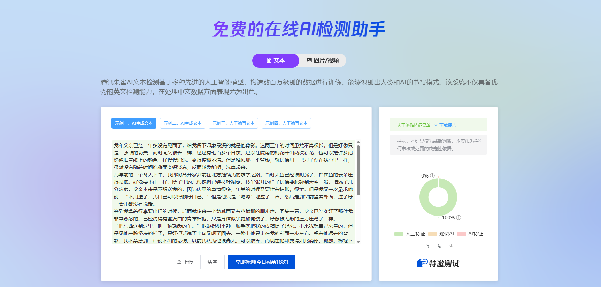
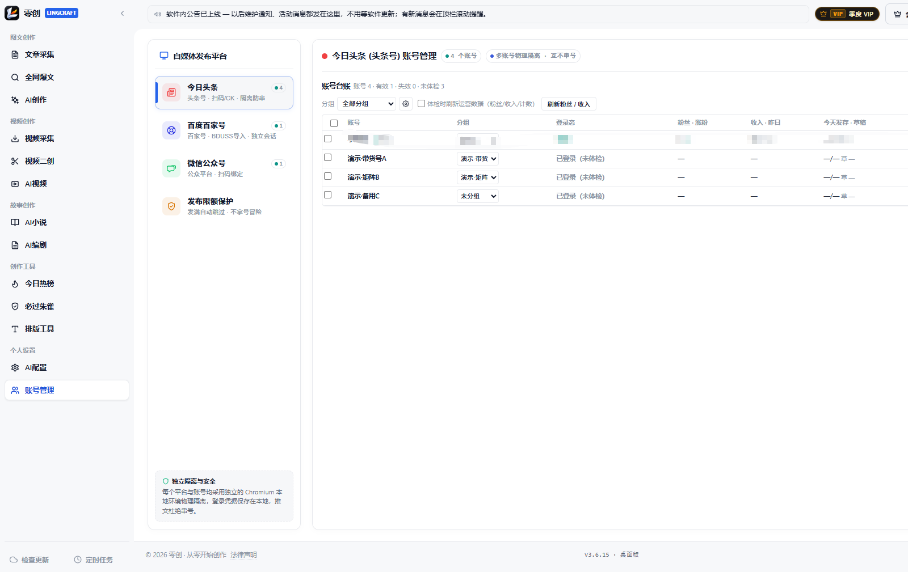

# 零创（LingCraft）· AI 自媒体写作与发布工具｜官方下载与版本页

> **一句话介绍**：零创（LingCraft）是一款 Windows 桌面 AI 写作与自媒体发布工具，支持 AI 原创、爆款二创、AI 配图，并可把文章发布到今日头条、微头条、百度百家号和微信公众号草稿箱。

> **核心差异点**：内置「必过朱雀」本地改写——几百次实测，改写后 **100% 通过腾讯朱雀检测，无一例外**（下方有改写前后的检测对照图）。

---

## 立即下载（当前版本 v3.6.16）

| 渠道 | 下载地址 |
| :--- | :--- |
| **魔搭 ModelScope（国内推荐）** | <https://www.modelscope.cn/models/lingxiaoyiyu/lingcraft-releases/resolve/master/LingCraft_Setup_v3.6.16.exe> |
| **GitHub Releases（海外 / 备用）** | <https://github.com/lingxiaoyiyu-hub/LingCraft-Release/releases/latest> |

- 文件名：`LingCraft_Setup_v3.6.16.exe`
- 大小：463.8 MB
- 平台：Windows 10 / 11 64 位
- SHA-256：`d2772cbc5f646984efbd9e81c2e37435732df2a33ffd6bfe569c437177fdadaf`

> 自 2026-10-27 起只提供安装版，**绿色免安装版已停止产出**；安装向导会自动探测旧目录并覆盖升级，作品、账号登录状态与配置全部保留，**不需要先卸载**。版本号与哈希以本页、魔搭发布页和云端 `version.json` 为准。

**系统要求**：Windows 10 / 11 64 位；微信公众号扫码绑定需本机已安装 Microsoft Edge 或 Google Chrome。首次运行如遇 SmartScreen 提示，点「更多信息」→「仍要运行」。

## 三步上手

1. 下载上面的 `LingCraft_Setup_v3.6.16.exe` 并双击安装。
2. 打开软件，输入授权卡密激活（获取卡密请联系作者，客服 QQ：574719738）。
3. 在「AI 配置」里选择内置免密钥通道，或填入自己的 DeepSeek / 豆包 / 智谱 / OpenAI 兼容接口 Key，点「测试连接」即可开始。

---

## 能做什么

### 必过朱雀：写完之后先过检测

把 AI 生成或二创的稿子交给本机端侧模型改写，降低 AI 写作特征；两档强度（自然通顺 / 深度破碎），逐段对照、单段精修，改完可以直接拿朱雀复测。改写在本机完成，不上传原文，也不消耗云端模型额度。

**在线试用（每天 3 次免费）**：<https://www.modelscope.cn/studios/lingxiaoyiyu/xcbot>。在线版跑在魔搭云端，需要提交文本；不限次数、批量处理、原文不上传，用桌面版。

| 改写前 | 改写后 |
| :---: | :---: |
|  |  |

**结论：几百次测试，改写后 100% 通过朱雀检测，无一例外。** 朱雀的检测模型会更新，发布前建议用当天页面复测；个别段落不理想时，切「深度破碎」档或对该段重新精修即可。

### AI 原创与爆款二创

- 按今日头条、微信公众号、知乎、小红书等平台文风生成完整文章；支持两遍式写作（先事实与结构、再文风精修）、自定义提示词、目标字数与构思深度。
- 爆款二创先把原文拆成「事实卡」，再只用事实重新组织成新稿，减少原文句式残留；写完后可再过一遍「必过朱雀」。
- AI 配图支持 AI 生图与原文采集图，可按正文段落绑定，避免多篇串图。

### 多平台发布（头条 / 微头条 / 百家号 / 公众号）

- **今日头条**：草稿箱或直接发布，支持批量与软件内定时。
- **微头条**：批量发布与软件内定时，按账号分槽排期。
- **百度百家号**：草稿或直发，支持封面、定时与商品挂载。
- **微信公众号**：一键存草稿箱，内置 28 套排版主题，正文配图自动转存微信图床。
- 头条与百家号登录态物理隔离，账号台账可看分组、粉丝、昨日收入与当日发稿/草稿数。

### 选题采集、视频与故事创作

- **文章采集**：头条作者文章与 18 个垂直赛道实时爆文，配图自动下载。
- **视频采集与二创**：抖音作者主页/单作品/爆款视频采集；本机 ffmpeg 批量重剪降痕、去水印、22 款变声，原片保留。
- **AI 视频**：文案 → 口播稿 → 14 款中文音色配音 → 素材混剪 → 双行字幕 → 内置 BGM → 本机合成 MP4。
- **AI 小说工坊**：世界观、角色档案、分卷大纲、逐章扩写，支持 txt / md / docx 导入整部作品。
- **AI 编剧工坊**：剧本重构 → 视觉资产 → 影视分镜三步，分镜表可导出 Excel / CSV / Markdown / Word。

---

## 版本历史

| 版本 | 日期 | 主要变化 |
| :--- | :--- | :--- |
| v3.6.16 | 2026-10-29 | 发布链路修复（头条上限空转、批量多账号错发、百家号/公众号批量记错、登录失效整队收手）、AI 视频「一张图 · 纯图文成片」、AI 报错统一提示、首次启动法律声明确认 |
| v3.6.15 | 2026-10-27 | 长故事创作、AI 配图并发出图、爆款选题池持久化；头条/百家号发布与登录失效处理修复 |
| v3.6.14 | 2026-10-26 | 修复 AI 视频按钮无反应；二创结果实时落盘；显卡编码失败写明原因并回退 CPU；二创新增诊断日志 |
| v3.6.13 | 2026-10-26 | 批量生成 AI 视频、去水印自动识别、软件内公告栏、跨分页全选；修复润色不出文章与配图段落错位 |
| v3.6.12 | 2026-10-22 | 左侧栏改版、定时发布按账号分槽、爆款视频独立采集、去水印与变声、必过朱雀独立板块 |
| v3.6.11 | 2026-10-17 | 断流自动续写、公众号 28 套排版主题、爆文采集空壳修复、单文件 HTML 导出 |

完整历史见 [CHANGELOG.md](CHANGELOG.md)，每个版本的安装包与 SHA-256 见 [Releases](https://github.com/lingxiaoyiyu-hub/LingCraft-Release/releases)。

## 常见问题（摘要）

**Q：软件升级后作品会丢吗？**

A：不会。直接下载新版 Setup.exe 覆盖安装即可，作品、小说章节、分镜、配置与账号登录状态全部保留，不需要先卸载。

**Q：数据保存在哪里？换电脑怎么备份？**

A：本机 `C:\Users\<用户名>\AppData\Roaming\XCbot_ToutiaoStudio`。换机前备份该目录，复制到新电脑对应位置即可。

**Q：换电脑后卡密怎么办？**

A：卡密一卡一机，支持每月 2 次自主解绑换机；解绑后在新电脑重新激活。

**Q：真的能 100% 过朱雀吗？**

A：按目前的测试样本（几百篇，覆盖不同题材与长度），改写后全部通过，无一例外。朱雀模型会更新，发布前建议当天复测。不想先装软件，可以先用[在线试用版](https://www.modelscope.cn/studios/lingxiaoyiyu/xcbot)（每天 3 次免费）验证效果。

**Q：公众号能直接群发吗？**

A：不能。微信接口只开放到草稿箱，零创把稿子和排版存进草稿，最后一步在公众号后台确认发布。

**Q：支持 Mac 或手机吗？**

A：目前只提供 Windows 10 / 11 64 位桌面版。

更多安装、数据、模型与安全说明见 [FAQ.md](FAQ.md)、[INSTALL_GUIDE.md](INSTALL_GUIDE.md)、[SECURITY.md](SECURITY.md)。

## 授权说明

零创是 Windows 桌面商业软件，不是免费开源软件。使用需授权卡密，获取卡密请联系作者：**客服 QQ 574719738**。卡密一卡一机，支持每月 2 次自主解绑换机。

## 更多资料

- 主获客页（功能全景）：<https://github.com/lingxiaoyiyu-hub/LingCraft-AI-writing-tool>
- 朱雀检测与降 AI 味：<https://github.com/lingxiaoyiyu-hub/zhuque-ai-humanizer>
- 文章转视频 / 图文成片：<https://github.com/lingxiaoyiyu-hub/article-to-video-desktop>
- 视频二创 / 去水印：<https://github.com/lingxiaoyiyu-hub/video-remix-tool>
- 公众号写作 / 排版：<https://github.com/lingxiaoyiyu-hub/wechat-writing-tool>
- 2026 自媒体 AI 工具横评：<https://github.com/lingxiaoyiyu-hub/self-media-tools-2026>

## 免责声明

零创仅用于辅助内容创作与提高发布效率。使用者应遵守《著作权法》及各平台运营规范，不得发布违法违规、侵权或虚假内容；采集内容版权归原作者。软件不承诺流量、推荐量或收益。请通过本页或官方发布页下载，破解版与二次打包版本可能携带木马。
