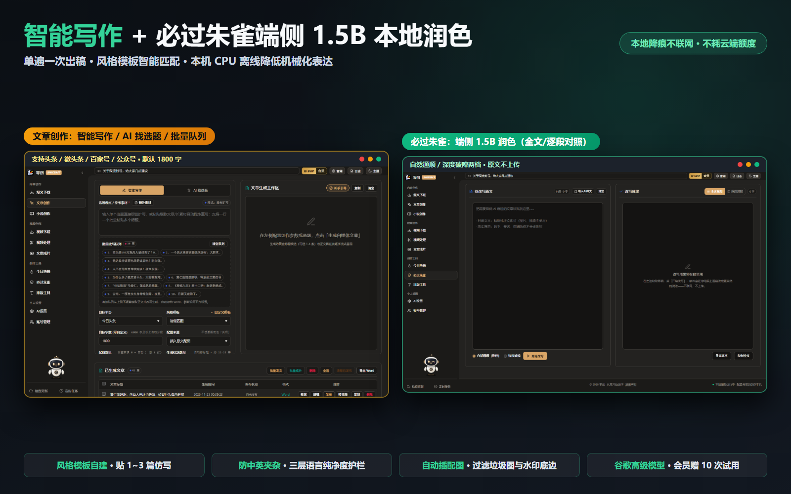
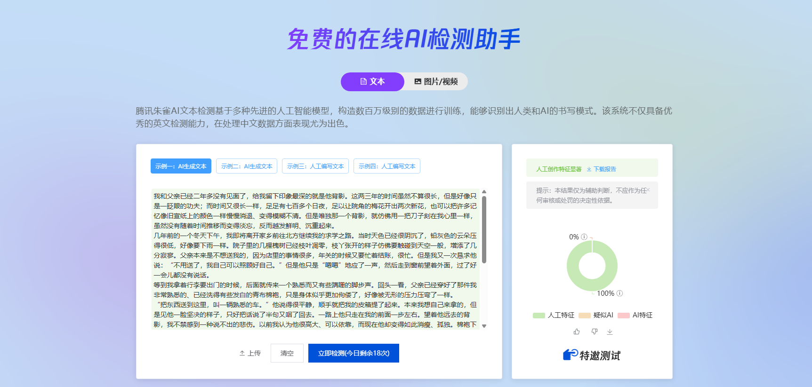

# 零创（LingCraft）· AI 自媒体与长篇小说创作工作台

> Windows 原生桌面创作工作台：爆文下载筛选 → 单遍智能写作 → 端侧 1.5B 本地润色 → 视频下载重剪与文案成片 → AI 长篇小说工坊 → 头条 / 微头条 / 百家号 / 公众号发布与代理 IP 隔离。

> **核心差异点**：内置「必过朱雀」端侧 1.5B 本地文本润色——纯本机运行、不上传原文、不消耗云端模型额度；配合四套护眼主题与桌面小助手「零零」，界面所见即所得。

## 立即下载（当前版本 v6.0.3）

- **[下载 LingCraft_Setup_v6.0.3.exe（安装向导版）](https://www.modelscope.cn/models/lingxiaoyiyu/lingcraft-releases/resolve/master/LingCraft_Setup_v6.0.3.exe)**
  （474.2 MB ｜ Windows 10 / 11 64 位 ｜ 魔搭直链不限速 ｜ 自动覆盖升级免卸载）
- 文件名：`LingCraft_Setup_v6.0.3.exe`
- 文件大小：497,253,204 字节 / 474.2 MB
- SHA-256：`2d96fc7314b6fafd4980a28409171bb131f9b8d6e2c7bc3f2f5da2eb4b770710`
- 海外与极客备用通道：[GitHub Releases 官方发行页面](https://github.com/lingxiaoyiyu-hub/LingCraft-Release/releases/latest)
- 国内主源：[魔搭 ModelScope 发布页](https://www.modelscope.cn/models/lingxiaoyiyu/lingcraft-releases)

> 安装向导会自动探测历史安装目录并覆盖升级，作品库、账号登录状态与配置全部保留，**不需要先卸载**。升级只有全量安装包这一条路径。

---

## 核心功能一览

### 1. 爆文下载 · 分类批量抓取与全网爆文筛选

- **一页两卡高效选材**：合并「分类下载」与「全网爆文」两大入口，支持头条作者主页 / 频道批量抓取，以及头条 / 百家号全网高阅读爆文筛选（支持加载更多深挖至 2000 篇）。
- **自动屏蔽官媒及机构号**：默认自动过滤官媒与机构账号，指定作者链接正常放行；自动折叠高风险赛道并给出提示。
- **配图自净化与独立导出**：下载时自动过滤关注引导横幅与章节分隔条，支持按篇导出独立 Word 文档，并可一键勾选批量送入「文章创作」或「文案成片」。

### 2. 智能写作 + 「必过朱雀」端侧 1.5B 本地润色

- **单遍一次出稿**：合并原创扩写与爆款改写为「智能写作」，贴标题清单按原创走、贴长文按改写走，自动分流；目标字数默认 1800 字，支持三层防中英夹杂护栏与原文配图/AI 生图自动插图。
- **风格模板智能匹配**：默认按题材智能匹配范文并收敛为克制耐读的专栏白话；支持贴 1~3 篇自己的成稿自建专属风格模板，另含独立「AI 找选题」工作区。
- **必过朱雀 · 端侧本地润色**：内置本机 1.5B 量化润色模型，提供「自然通顺（推荐）」与「深度破障」两档强度，支持全文视图与逐段对照精修。改写全程在本机 CPU 完成，**不上传原文、不联网、不消耗云端模型额度**。

| 改写前 | 改写后 |
| :---: | :---: |
|  |  |

**在线试用（每天 3 次免费）**：<https://www.modelscope.cn/studios/lingxiaoyiyu/xcbot>。在线版跑在魔搭云端，需要提交文本；不限次数、批量处理、原文不上传，请使用桌面客户端。

### 3. 视频下载、本地重剪与文案成片

- **视频下载**：支持抖音作者主页、单作品、短链及爆款视频批量下载，大文件并发分片提速并支持随时「停止下载」，作品统一入库管理。
- **视频处理（纯本机 ffmpeg）**：全程零联网零模型，提供标准/强烈降重方案、自动消黑边、片头卡与封面帧、22 款变声预设（支持本地试听）以及按画面比例框选模糊去水印；产物另存「已处理」目录，绝不覆盖原片。
- **文案成片（含花生AI 成片）**：支持直接将文章一键转为短视频口播脚本，内置原声 + 7 种常用中文音色、8 首精选 BGM 与自动字幕；接入花生AI 云端成片（扫码登录直出），成片自动落入「视频成果库」，支持 9:16 竖屏与 16:9 横屏，并可在软件内直接发布到今日头条与百度百家号（自动截横版封面）。

### 4. AI 长篇小说工坊

- **仿真书房 + 三栏沉浸创作台**：内置多套仿真书封与自定义装帧，支持 txt / md / docx 整部作品自动识别分卷分章导入，兼容 4 套护眼主题（默认黑金 / 纯净白 / 豆沙绿 / 羊皮卷）。
- **跨卷连续创作**：点击一次按章节顺序自动往下写，每章写完自动定稿并更新摘要、角色履历与记忆卡，跨卷章号连续不串戏；右栏随时调用概要、设定、角色、文风、检测与灵感工具，支持一键排版与全书 Word 导出。

### 5. 多平台发布、IP 隔离与本地排版工具

- **多平台物理隔离发布**：支持今日头条（图文/微头条）、百度百家号直发或存草稿，以及微信公众号一键存草稿箱（内置 28 套精美排版主题，正文配图自动转存微信图床）。
- **出口 IP 隔离与定时发布**：支持代理池配置与按账号绑定独立出口 IP，防串号拦截；支持固定间隔 / 随机间隔 / 时段内随机 / 每日固定时刻 4 种定时发布节奏，按账号独立分槽排期，重启后自动恢复。
- **文字排版助手 & 多模型接入**：内置纯本地文字排版工具（清除 HTML、一键排版、段落空行、错别字与繁简转换，内容不上传）；模型兼容 DeepSeek / 通义千问 / 智谱清言 / Kimi / OpenAI 格式自备 Key，另内置 **谷歌 Gemini 高级写作模型通道**（会员赠送 10 次试用，生成异常自动幂等退回次数）。

---

## 三步上手

1. 下载并运行 `LingCraft_Setup_v6.0.3.exe` 进行安装（如遇 Windows SmartScreen 拦截：点「更多信息」→「仍要运行」）。
2. 输入授权卡密激活（老用户覆盖升级免激活，作品、账号登录状态与配置全部保留）。
3. 跟着各板块内置的**交互式新手引导**，在「AI 设置」选择内置高级通道或填入自备模型 API Key，即可开始全流程创作。

## 授权说明

零创是 Windows 桌面商业软件，使用需授权卡密（未激活状态不开放功能）；授权方式与获取渠道见软件官网 [xcbot.cyou](https://xcbot.cyou)。

- **会员档位**：月卡 ¥128 ｜ 年卡 SVIP ¥588（含高级模型充值折扣特权）｜ 体验卡密（季卡已下线，老卡照常可用）。
- **高级模型计费**：会员自带 10 次谷歌 Gemini 高级模型免费试用，支持在「AI 设置 → 高级次数」粘贴 `LCG-` 兑换码充值，失败自动退回次数；端侧本地润色与本地 ffmpeg 视频处理不消耗云端次数。
- **换机与升级**：卡密一卡一机，支持单端在线核销与每月 2 次自主解绑换机；软件内点击「检查更新」即可一键下载并覆盖升级。

## 常见问题

**双击被 Windows SmartScreen 拦截？**
点「更多信息」→「仍要运行」。独立桌面软件未采购高额 EV 代码签名证书时会触发系统提示，本软件通过 Ed25519 数字签名防篡改核验，请放心使用。

**老版本怎么升级？会丢失我写好的文章、小说或账号登录态吗？**
直接下载新版 Setup 安装包覆盖安装即可，**不需要先卸载**。数据独立保存在本地 `C:\Users\<用户名>\AppData\Roaming\XCbot_ToutiaoStudio`，覆盖升级全部保留。

**端侧 1.5B 润色模型和视频处理需要独立显卡吗？**
不需要。端侧 1.5B 润色经过量化优化，普通办公 CPU 即可流畅运行；视频重剪与变声全部在本机 ffmpeg 完成，全程零联网。

**公众号能直接群发吗？**
不能。微信接口只开放到草稿箱，零创负责将文章与排版一键存进草稿箱，最后一步请在公众号后台确认发送。

## 更新日志

- **v6.0.3**（2026-11-25）：修复了「AI 找选题」点击生成选题时报错无法出题的问题；修复了全网爆文连续切换筛选时旧结果覆盖及翻页误清空勾选的问题
- **v6.0.2**（2026-11-25）：新增爆文独立按篇导出 Word、原文配图自动过滤关注横幅与章节分隔条、抖音/热门视频批量下载「停止下载」与顶栏「官网」入口；修复批量或定时发布撞上限/掉线假成功/取消单篇误伤其他排期、创作中断或未出正文退回高级次数及已成稿丢失、确认弹窗按 ESC 误执行、小说删卷章号错乱及导出乱序、视频处理裁黑边变形/处理卡死、下载勾选错位误导出全库、系统代理异常启动卡死、卸载定位失败及花生AI 音色假项与扫码换号问题；优化原创与改写单遍一次出稿并提速抖音并发分片下载，文章默认字数调为 1800 字、批量并发上限统一为 5 路
- **v6.0.1**（2026-11-23）：修复了花生AI 账号区会员状态与花生米余额始终显示为 0 的问题，现在会显示当前登录的昵称、会员有效期与余额，花生米不足的提示里也会写明这些信息
- **v6.0.0**（2026-11-23）：新增谷歌 Gemini 高级写作模型通道（会员赠 10 次试用，支持卡密兑换充值、按次计费且异常失败自动退回次数）；上线文章、小说、视频与 AI 设置交互式新手引导；推出年度 SVIP 方案与顶栏按卡种区分的金属会员徽标；修复单篇创作写完正文后卡在配图假死、垃圾图误插及文案成片拆分镜重复扣次等问题；优化爆文下载高风险赛道折叠警示、统一多处列表勾选导出 Word，成片默认自动匹配随机背景音乐并精简多项设置入口
- **v5.0.5**（2026-11-18）：新增账号出口 IP 隔离（支持代理池配置与一键给多账号分配独立代理）与正文完成后单独提炼三段式标题；修复已生成文章导出 ZIP 报错、带密码代理无法联网及健康代理误判问题；合并「文章下载」与「全网爆文」为「爆文下载」一页两卡，配图合并为「自动配图（推荐）」默认开箱即用，并精简设置页与低频入口
- **v5.0.4**（2026-11-16）：全网爆文支持「加载更多」深挖（首屏 500+ 篇、可扩至 2000 篇），智能写作默认新增「智能匹配」按题材自动配范文，爆款视频库新增底部分页导航与跨页同步勾选；修复头条发布默认误选「取材网络」、官媒屏蔽漏网问题等 8 项问题；升级「零零」多种新动作表情与单入口顶栏会员徽标
- **v5.0.3**（2026-11-14）：板块下载与全网爆文自动屏蔽官媒及机构号（指定作者链接仍可下载）；文章与爆文并发抓取与并发处理配图大幅提速；「零零」小助手换新流线白瓷造型
- **v5.0.0**（2026-11-13）：花生AI 一键剪成片上线；视频可在软件内一键发布到头条与百家号（自动封面与创作声明，支持批量定时）；文章库与爆文库新增「转视频」「批量成片」
- **v4.0.6**（2026-11-09）：原创与爆款改写合并为「智能写作」；小说正文支持**连续创作**；公众号存草稿自动设置封面；视频处理新增自动黑边消除、镜头切点吸附与呼吸式微运镜
- **v4.0.5**（2026-11-07）：侧栏终端小精灵「零零」上线，顶部公告栏改为自适应分屏淡入淡出
- **v3.6.0**（2026-10-03）：软件更名为「零创」、标语改为「从零开始创作」，应用图标全新设计
- **v3.4.0**（2026-08-31）：上线 AI 长篇小说工坊

## 商业许可与版权声明

LingCraft（零创）为商业授权软件，受《中华人民共和国著作权法》及国际版权公约保护。

- **专有权利**：本软件所有代码架构、编译产物、核心创作模型提示词编排体系及界面设计，其著作权及商业秘密均归开发团队独家所有。
- **禁止行为**：未经官方书面许可，任何组织或个人不得对本软件进行反编译、反汇编、逆向工程、去除授权校验或制作分发衍生破解补丁；不得将本软件用于任何形式的商业转售、倒卖或公开镜像分发。
- **追责声明**：本软件内置云端付费计算资产与动态鉴权审计。对于任何非法破解、盗用商业 Token 及恶意传播侵权版本的行为，官方保留直接诉诸司法机关追究民事索赔及法律责任的一切权利。
- **侵权举报与商务授权**：如发现第三方违规倒卖、破解补丁或侵权线索，欢迎联系官方邮箱：`lingxiaoyiyu@gmail.com`。

---

© 2026 LingCraft Team. All rights reserved.
